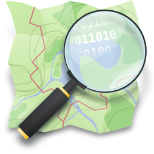

# language-openstreetmap 

OpenStreetMap and the OpenStreetMap magnifying glass logo are trademarks of the
OpenStreetMap Foundation, and are used with their permission. This adaptor is
not endorsed by or affiliated with the OpenStreetMap Foundation.

An OpenFn **_adaptor_** for reading OpenStreetMap data through the
[Overpass API](https://wiki.openstreetmap.org/wiki/Overpass_API). It is
read-only: it does not edit OpenStreetMap.

## Documentation

View the
[docs site](https://docs.openfn.org/adaptors/packages/openstreetmap-docs) for
full technical documentation.

Overpass API documentation:

- [Overpass API](https://wiki.openstreetmap.org/wiki/Overpass_API)
- [Overpass QL](https://wiki.openstreetmap.org/wiki/Overpass_API/Overpass_QL)
- [Overpass API user's manual](https://dev.overpass-api.de/overpass-doc/en/)
- [Map features](https://wiki.openstreetmap.org/wiki/Map_features), eg
  [Key:healthcare](https://wiki.openstreetmap.org/wiki/Key:healthcare)

### Configuration

No credentials are needed. By default the adaptor uses the public instance at
[overpass-api.de](https://overpass-api.de), with the base URL
`https://overpass-api.de/api` (an API path, not a web page). Set `baseUrl` to
the `/api` base URL of another or a self-hosted Overpass instance.

View the
[configuration-schema](https://docs.openfn.org/adaptors/packages/openstreetmap-configuration-schema/)
for required and optional `configuration` properties.

The configuration schema uses
[JSON Schema draft-07](https://json-schema.org/draft-07/json-schema-release-notes).
Run `pnpm validate:schemas` from the adaptors repo root after editing it.

### Usage limits

The public Overpass instances are shared and free. Regular automated use should
stay well within the
[public instance usage limits](https://wiki.openstreetmap.org/wiki/Overpass_API#Public_Overpass_API_instances)
(at the time of writing, fewer than 10,000 queries and less than 1 GB of
downloads per day). For production workloads, self-host Overpass and set
`baseUrl`.

Overpass has no pagination, so each query returns its whole result in one
response. If Overpass gives up on a query (for example it times out or runs out
of memory) the adaptor throws Overpass's own error rather than returning partial
data. For large extracts, narrow the area, raise `timeout`, or use
`changedSince` to fetch only recent changes.

### Data license

OpenStreetMap data is © OpenStreetMap contributors and available under the
[Open Database License (ODbL)](https://www.openstreetmap.org/copyright). Any
data published downstream, including maps, registries and exports, must credit
"© OpenStreetMap contributors".

## Development

Clone the [adaptors monorepo](https://github.com/OpenFn/adaptors). Follow the
"Getting Started" guide inside to get set up.

Run tests using `pnpm run test` or `pnpm run test:watch`

Build the project using `pnpm build`.

To build _only_ the docs run `pnpm build docs`.
