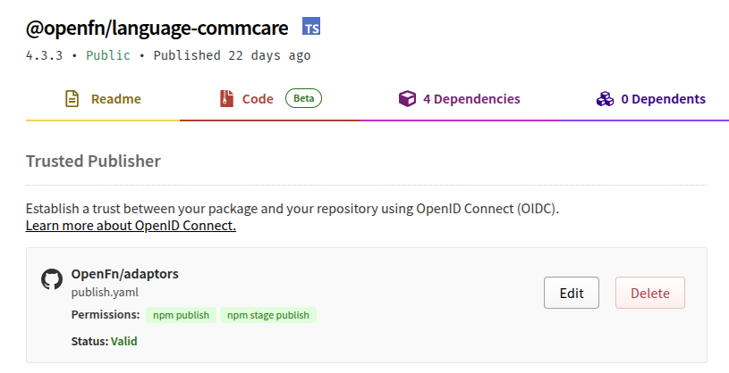

# Releases

This page describes how adaptors are released, from writing a changeset through
to a published package on npm.

- [Overview](#overview)
- [Trusted publishing](#trusted-publishing)
- [Releasing an update to an existing adaptor](#releasing-an-update-to-an-existing-adaptor)
- [Releasing a new adaptor](#releasing-a-new-adaptor)
- [Trusting a package](#trusting-a-package)
- [When publishing fails](#when-publishing-fails)
- [Command reference](#command-reference)

## Overview

Adaptor releases are mostly automated. Day to day, you should never need to run
`npm publish` yourself. Merge a PR with a changeset and CI does the rest.

In some cases, a maintainer with admin access to the `@openfn` organisation on
npmjs.org will need to take a manual step to authorise a release. This is a
result of Trusted Publishing with OIDC and important for security purposes. A
manual intervention is required once per adaptor.

## Trusted publishing

npm supports [Trusted Publishing](https://docs.npmjs.com/trusted-publishers),
which basically means that the npm repository is told that a specific GitHub
repo and workflow is allowed to publish a package by the `@openfn` organisation.

When that workflow runs, GitHub issues it a short-lived identity token (OIDC),
and npm accepts it in place of a login. No npm secret is stored in the repo.

Since September 2025, every adaptor package is configured to trust with the
following settings:

- Repository: `OpenFn/adaptors`
- Workflow: `.github/workflows/publish.yaml`

We also set the package's publishing access to "require two-factor
authentication and disallow tokens" (`npm access set mfa=publish`). That means
the only ways to publish an adaptor are the trusted workflow, or a human at a
terminal with 2FA. A leaked token can't be used to push a malicious release.

Note that Trust is configured **per package**, and a package must already exist
on npm before it can be trusted.

You can see the Trust settings for a published adaptor on its npmjs page, under
settings (visible only to collaborators)

This is what it looks like on npm (Settings tab of a package):



See https://www.npmjs.com/package/@openfn/language-commcare/access

## Releasing an update to an existing adaptor

This is the normal flow and is almost entirely automated.

### 1. Add a changeset

Every PR that changes an adaptor needs a changeset:

```bash
pnpm changeset
```

Pick the adaptor(s) affected, choose a bump (patch, minor or major) and describe
the change. This creates a markdown file in `.changeset/`. Commit it with your
PR.

### 2. Version the packages

Once your PR is approved, bump the versions and stamp release dates:

```bash
pnpm run version
```

This consumes the changesets, updates `package.json` versions and `CHANGELOG.md`
files, and adds release dates. Commit the result and push it to your PR branch.

Sometimes versioning is run on a release branch after merging.

### 3. Merge to `main`

Merging triggers the [Publish workflow](../.github/workflows/publish.yaml),
which will:

1. Install, validate configuration schemas, build, and run tests
2. Fill in any missing changelog dates (and commit them back to `main`)
3. Run `pnpm publish -r`, which publishes every package whose version is not yet
   on npm, authenticating through trusted publishing
4. Create git tags for each new version and push them
5. Post a notification to Slack
6. Update `docs/docs.json` and docs.openfn.org

You can watch progress in the Actions tab on GitHub. If the publish step fails,
see [When publishing fails](#when-publishing-fails).

## Releasing a new adaptor

Trusted publishing can't be set up until the package exists on npm, so the very
first release of an adaptor is done by hand by a maintainer with npm publish
rights. You'll need your authenticator app handy.

1. Merge the PR that adds the adaptor (with its changeset) as usual. The
   automated publish can't release the new package, so expect that step to fail
   for it.
2. From a clean, up-to-date checkout of `main`, run:

   ```bash
   pnpm publish:new <adaptor> <otp>
   ```

   Use the short name (`http`, not `@openfn/language-http`) and a fresh one-time
   password from your authenticator.

`publish:new` will:

1. Build the adaptor (skip with `--no-build`)
2. Publish it to npm
3. Tag the release and push the tag
4. Run the [trust step](#trusting-a-package) so all future releases are
   automated

If it refuses because the package is already on npm, then the first release has
already happened. Skip to [Trusting a package](#trusting-a-package).

If the publish and tag succeeded but the trust step failed (usually an expired
OTP) the package is live and **nothing is rolled back**. Don't run `publish:new`
again. Just [trust the package](#trusting-a-package).

## Trusting a package

Every adaptor must be manually configured for trust by a collaborator.

```bash
pnpm trust <adaptor> <otp>
```

For example, `pnpm trust common 123456` trusts `@openfn/language-common`. The
OTP must be fresh (they expire after about 30 seconds), so get it from your
authenticator immediately before running.

This will:

1. Check the package is published (otherwise it exits without using up your OTP)
2. Check whether it is already trusted, and stop if so
3. Register `OpenFn/adaptors` and `publish.yaml` as a trusted publisher
4. Set the package to require 2FA and disallow token publishes

Options:

- `--dry-run` shows what would happen without changing anything
- `--renew` revokes the existing trust and adds it again (see below)

Note that after trusting, the adaptor is granted temporary "pending" trusted
status. To have Trust permanently applied, a new version must be released within
48 hours. This is why trust must be renewed sometimes for older adaptors - see
Renewing Trust.

## When publishing fails

If the Publish workflow fails at the `pnpm publish` step, the most likely cause
is that a package's trust is missing or no longer valid. For example:

- The package was never trusted (a new adaptor that skipped the trust step)
- The trusted publisher config on npm was removed or changed
- The repository or workflow file was renamed, so it no longer matches what npm
  has on record

First check the workflow log to see which package was rejected. Then check the
package's Settings tab on npmjs.com to see whether a trusted publisher is
listed, and whether it points at `OpenFn/adaptors` and `publish.yaml`.

### Renewing trust

If trust is missing, wrong, or stale, revoke it and add it again:

```bash
pnpm trust <adaptor> <otp> --renew
```

For example:

```bash
pnpm trust common 123456 --renew
```

This looks up the existing trust entry, revokes it, and registers a new one for
the current repo and workflow. If the package isn't trusted yet, it just trusts
it. Without `--renew`, the script reports the existing entry and how to revoke
it manually (`npm trust revoke <package> --id <id>`) but changes nothing.

> Note: `pnpm trust:renew` does not exist as a standalone script at the time of
> writing. `--renew` is a flag on `pnpm trust`.

### Re-running the release

Packages that did publish are already on npm, so it is safe to re-run. Once
trust is fixed, re-run the failed workflow from the Actions tab (or push a fresh
commit to `main`). `pnpm publish -r` skips versions that already exist, so only
the missing packages are published. If the failure happened after the publish
step, check that tags were pushed (`git ls-remote --tags origin`) and that the
Slack notification went out.

### Other failures

| Symptom                                | Fix                                                          |
| -------------------------------------- | ------------------------------------------------------------ |
| "Your OTP was rejected"                | It expired or was mistyped. Get a fresh code and try again.  |
| "isn't published on npm yet"           | The package needs its first release with `pnpm publish:new`. |
| "already published" from `publish:new` | Use `pnpm trust <adaptor> <otp>` instead.                    |
| Build, lint or test failures in CI     | Fix on a branch and merge; nothing was published.            |

## Command reference

| Command                              | What it does                                            |
| ------------------------------------ | ------------------------------------------------------- |
| `pnpm changeset`                     | Create a changeset for your changes                     |
| `pnpm run version`                   | Apply changesets, bump versions, update changelog dates |
| `pnpm publish:new <adaptor> <otp>`   | First release of a new adaptor (publish, tag, trust)    |
| `pnpm trust <adaptor> <otp>`         | Set up trusted publishing for one adaptor               |
| `pnpm trust <adaptor> <otp> --renew` | Revoke and re-add trust for one adaptor                 |
| `pnpm trust:all <otp>`               | Set up trusted publishing for every published adaptor   |
